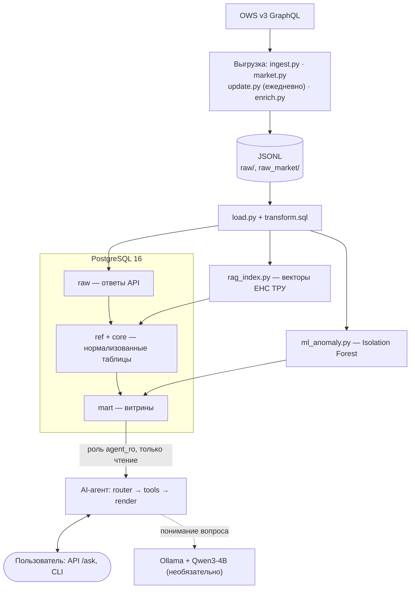
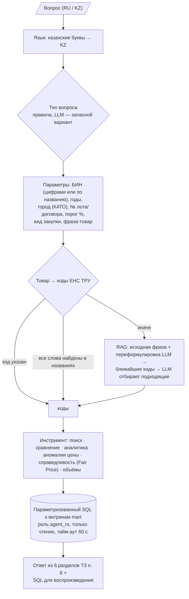
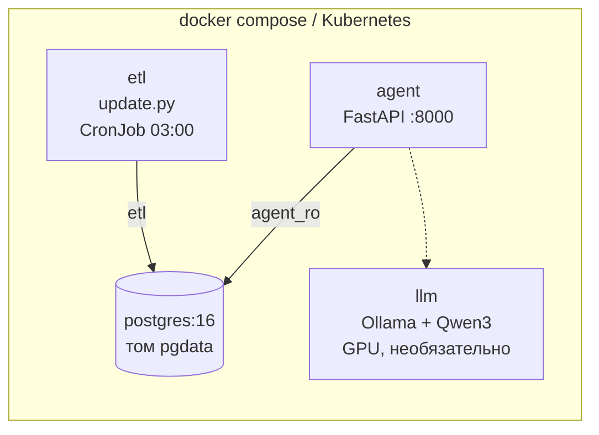

# 1. Архитектура

AI-агент отвечает на вопросы о государственных закупках 27 организаций за 2024–2026 годы по данным API OWS v3. Принцип: **цифры считает SQL, а не языковая модель** (ТЗ п. 10). LLM и семантический поиск используются только для того, чтобы понять вопрос и найти нужный код ЕНС ТРУ.

## 1.1. Общая схема (API → хранилище → аналитика → агент)

## 1.2. Компоненты

| Компонент | Файл | Назначение |
|---|---|---|
| Первичная выгрузка | `ingest.py` | Договоры, планы и лоты 27 организаций за 2024–2026 годы; продолжает с места остановки (`.state` / `.done`) |
| Рыночная выборка | `market.py` | Договоры **любых** заказчиков по 100 кодам ЕНС ТРУ с наибольшей суммой — база сравнения для Fair Price |
| Ежедневное обновление | `update.py` | Только новые и изменённые записи с последней загрузки, затем `load.py` |
| Дозагрузка полей | `enrich.py` | Вид предмета закупки, поставщик, казахские названия ЕНС ТРУ — без полной перевыгрузки |
| Загрузка и пересчёт | `load.py` + `db/transform.sql` | JSONL → `raw` (upsert) → `ref`/`core` → проверки качества → витрины `mart` → ML → RAG-индекс |
| ML-слой | `ml_anomaly.py` | Isolation Forest и итоговый уровень риска |
| RAG-индекс | `rag_index.py` | Векторы названий ЕНС ТРУ (`multilingual-e5-small`) |
| Агент | `agent/` | `router` → `tools` → `render`; `semantic` (RAG), `llm` (Qwen3) |
| HTTP API | `agent/api.py` | FastAPI: `POST /ask`, `GET /health`, `/docs` |
| Оценка качества | `eval/` | Эталонные вопросы, точность фактов, поиск товара |

## 1.3. Выбор эндпоинтов OWS v3 (ТЗ п. 2, 9)

Структуру API я изучил по GraphQL-схеме: сущности, поля, фильтры, объёмы по каждому БИН.

| Сущность ТЗ п. 9 | Источник в OWS v3 | Как выгружается |
|---|---|---|
| Договоры | `Contract` + вложенные `ContractUnits` | `filter: {customerBin, finYear}` |
| План | `Plans` | `filter: {subjectBiin, plnPointYear}` |
| Лоты | `Lots` | `filter: {customerBin}`, остановка на лотах старше 2024 года |
| Объявления | `Lots.TrdBuy` (вложенно) | вместе с лотами |
| Вид услуги (товар / работа / услуга) | `Contract.RefSubjectType`, `Plans.RefSubjectType` | официальное поле `refSubjectTypeId` |
| Заказчики | `Subjects` | 27 БИН из ТЗ |
| Поставщики | `Contract.Supplier` (вложенно) | БИН и название — без отдельных запросов |
| Статусы / результаты | `RefContractStatus`, `RefLotsStatus`, `RefBuyStatus`, `RefPlnPointStatus` | вложенно |
| Справочники | `RefEnstru` (RU + KZ), `RefUnits`, `PlansKato`, `RefTradeMethods` | вложенно |

**Что сознательно не используется:**
- **`ObContract`.** Проверка показала, что он дублирует `Contract`: 198 из 199 договоров совпадают по `id`, при этом вложенные планы пустые.
- **`TrdApp` (заявки) и `Acts` (акты).** Для обязательных вопросов ТЗ п. 4 они не нужны.

## 1.4. Инкрементальное обновление (ТЗ п. 3.6)

- **`Contract` и `Plans`** запрашиваются с аргументом `after_index_date`. Выдача идёт по возрастанию `indexDate`, следующая страница — по `lastIndexDate`. Курсор включительный, поэтому повторы на границе отсекаются по `id`.
- **`Lots`** такого аргумента не имеют. Для них используется фильтр `indexDate`, который работает как «не раньше».
- **Отправная точка** — водяной знак `etl.watermark`: последний `indexDate` по сущности и БИН с запасом в 1 минуту.
- **Расписание** — ежедневно в 03:00: Планировщик Windows, cron или Kubernetes CronJob. Один цикл (скачивание и пересчёт) занимает 8–9 минут, поэтому задержка от публикации на портале — **не более 24 часов**.
- **Актуальность в ответе.** Каждый ответ агента показывает время последней загрузки. Если она старше 24 часов, выводится предупреждение.

## 1.5. Логика AI-агента

- **Шесть инструментов** — это готовые параметризованные SQL-запросы. Агент не генерирует SQL «на лету»: это убирает класс ошибок, при котором LLM пишет неверный запрос и выдаёт неверные цифры.
- **LLM необязательна.** Без неё агент работает на правилах и RAG, а пороги для этого режима подобраны отдельно.
- **Языки.** Агент отвечает на русском и казахском. Язык ответа совпадает с языком вопроса.

## 1.6. Развёртывание (ТЗ п. 11)

| Среда | Файлы |
|---|---|
| Один сервер | `docker-compose.yml`: `db`, `agent`, `etl`, `agent-cli`, `llm` |
| Kubernetes | `k8s/`: Namespace, Secret, ConfigMap, PostgreSQL StatefulSet, PVC, первичная выгрузка (Job), ежедневное обновление (CronJob), агент (Deployment, 2 реплики), LLM; порядок — `k8s/README.md` |
| Без контейнеров | `scheduler/register_windows_task.ps1`, `scheduler/crontab.txt` |

**Образ.** Один образ на всё — `Dockerfile`, Python 3.13 и CPU-сборка torch. Модель эмбеддингов лежит внутри образа, поэтому всё работает без доступа к интернету.

**Безопасность:**
- **Токены и пароли** передаются только через переменные окружения или Kubernetes Secret, в образ не попадают; `*.env` в `.gitignore`.
- **Права агента.** Агент подключается ролью `agent_ro`: только чтение, `default_transaction_read_only`, `statement_timeout = 60 с`. Токена OWS и пароля `etl` у него нет.
- **Пароль `agent_ro`** при каждой загрузке выставляется из окружения, поэтому не расходится с тем, что задано в настройках.

## 1.7. Технологии

| Слой | Технология |
|---|---|
| Хранилище | PostgreSQL 16 (материализованные представления, `jsonb`, `percentile_cont`) |
| ETL, аналитика | Python 3.13, psycopg2, pandas, numpy |
| ML | scikit-learn 1.7 (Isolation Forest) |
| RAG | sentence-transformers, `intfloat/multilingual-e5-small` (RU / KZ, CPU) |
| LLM | Ollama 0.6.8, `qwen3:4b-instruct-2507` (локально, GPU / CPU) |
| API | FastAPI, uvicorn |
| Инфраструктура | Docker, docker compose, Kubernetes |
