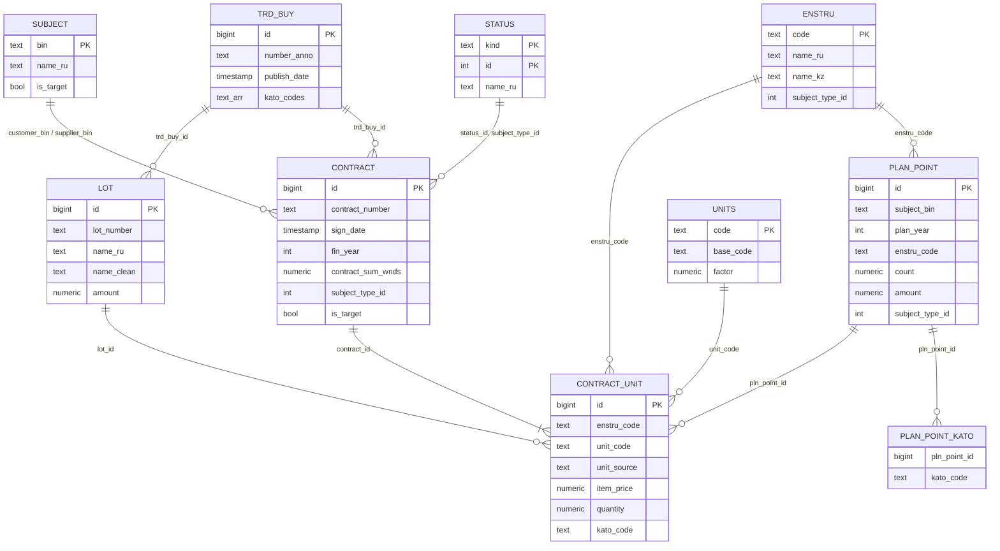

# 2. Схема хранения данных

PostgreSQL 16, одна база `goszakup`, пять схем-слоёв. DDL: `db/init/01–05_*.sql` (новая база), `db/migrations/` (изменения работающей базы), пересборка `ref`/`core` — `db/transform.sql`.

## 2.1. Слои

| Схема | Что хранит | Принцип |
|---|---|---|
| `raw` | Записи API как есть: `payload jsonb`, `index_date` | Ничего не теряем: новое поле не требует перевыгрузки. Upsert по `id`, только более свежая версия; для договоров версия из выгрузки 27 организаций приоритетнее рыночной |
| `ref` | Справочники: ЕНС ТРУ (RU / KZ), единицы с коэффициентами, КАТО, статусы, способы закупки, ИПЦ, векторы RAG | Пополняются из вложенных объектов API; коэффициенты единиц и ИПЦ — вручную |
| `core` | Нормализованные таблицы | Полностью пересобираются из `raw` при каждой загрузке (около 90 с) — нет «хвостов» от удалённых записей |
| `mart` | Материализованные витрины для агента | Готовые расчёты: LLM ничего не считает |
| `etl` | Журнал загрузок, загруженные файлы, водяные знаки, проблемы качества | Повторяемость и инкрементальность |

## 2.2. Модель данных core и ref

Жёсткие внешние ключи стоят только там, где обе стороны гарантированно есть в базе: `lot → trd_buy`, `contract_unit → contract`, `plan_point_kato → plan_point`. У рыночных договоров нет лотов и планов в базе, поэтому остальные связи логические.

## 2.3. Витрины mart

| Витрина | Строка | Назначение |
|---|---|---|
| `unit_price` | позиция договора | Цена без НДС, в тенге, за базовую единицу и в сопоставимых ценах (ИПЦ); регион, вид закупки, ссылка на объявление |
| `enstru_price_stats` | код × единица | n, средневзвешенная цена, медиана, p25 / p75, MAD — для аномалий цены |
| `region_coef` | код × единица × область | Региональный коэффициент (со сглаживанием) |
| `season_coef` | код × единица × месяц | Сезонный коэффициент, только если он статистически обоснован |
| `fair_price` | позиция договора 27 организаций | Fair Price, отклонение D, z по MAD, флаг IQR, вердикт, уверенность, ID аналогов |
| `qty_by_year` | заказчик × код × год | План и договоры: количество и сумма |
| `qty_anomaly` | заказчик × код × год | Рост объёма к прошлым годам и вердикт |
| `ml_anomaly` (таблица) | позиция договора | Оценка Isolation Forest, объяснение, итоговый уровень риска |

Пересчёт — `mart.refresh_all()`, затем `ANALYZE` (около 2 минут).

## 2.4. Объёмы (на 23.10.2026)

| Таблица | Строк | Таблица | Строк |
|---|---|---|---|
| `core.contract` (из них 27 орг.) | 49 729 (37 918) | `mart.unit_price` | 90 352 |
| `core.contract_unit` | 135 719 | `mart.fair_price` | 68 622 |
| `core.plan_point` | 69 414 | `mart.enstru_price_stats` | 11 779 |
| `core.lot` / `core.trd_buy` | 117 542 / 37 075 | `mart.qty_anomaly` | 12 035 |
| `core.subject` | 19 193 | `mart.ml_anomaly` | 30 493 |
| `ref.enstru` (векторов RAG) | 8 764 (8 764) | `ref.cpi` | 34 месяца |

**Договоры 27 организаций** (действующие, сумма с НДС): 2024 — 11 186 на 90,5 млрд тг; 2025 — 10 637 на 87,5 млрд тг; 2026 — 8 912 на 90,8 млрд тг (по 22.10.2026).

**Рыночная выборка** — 11 811 договоров других заказчиков, 1 685 кодов ЕНС ТРУ. Размер базы — 762 МБ.

## 2.5. ETL: очистка и нормализация (ТЗ п. 2.2)

| Задача | Решение | Результат |
|---|---|---|
| Единицы измерения | `ref.units.base_code / factor`: тонна → кг (×1000), грамм → кг, м³ → литр, см → метр, «метр погонный» → метр; цена и количество пересчитываются в базовую единицу | Цены сравнимы между договорами в разных единицах |
| Пропуски единиц | API не отдаёт часть заменённых версий пунктов плана; единица выводится: план того же заказчика → типичная единица кода (≥ 90%). Источник хранится в `unit_source` | Из 135 719 позиций: из плана — 114 423, выведено — 13 614, правило типичной единицы верно в 99,06% проверок; без единицы — 7 682 (исключены из сравнения цен) |
| Место поставки | Цепочка: пункт плана → лот → объявление; пустые строки вместо КАТО обнуляются | Без КАТО — 15% позиций (в основном рыночные) |
| Названия лотов | `core.clean_name`: глаголы в начале («Приобретение…»), год и срок в хвосте, подразделение в скобках, «и.т.д.», слитные запятые, ВЕРХНИЙ РЕГИСТР, латинские буквы-двойники («Cантехнические») | Изменено 2 570 названий; разных написаний 5 332 → 5 169 |
| Версии и статусы | Исключаются «Не заключен», «Расторгнут», «Проект» и **«Изменен»** (старая версия договора до доп. соглашения — иначе двойной счёт) | Убрано около 22 тыс. дублей позиций |
| Вид предмета закупки | Официальное поле `refSubjectTypeId`; для рыночных договоров — преобладающий вид по коду | Договоры 27 организаций — 100%; совпадение вида договора и пункта плана — 87 387 из 87 387 |
| Поставщики | Название из вложенного `Supplier` | 9 061 из 9 346 БИН, 99,9% суммы |

## 2.6. Контроль качества данных (ТЗ п. 11)

При каждой загрузке правила пишут найденные проблемы в `etl.dq_issue`. Доли проблем по позициям, на которых построен конкретный вывод, агент показывает в разделе 5 ответа.

| Проверка | Найдено |
|---|---|
| Позиция без места поставки (КАТО) | 20 329 |
| Позиция без единицы измерения | 7 682 |
| `totalSum ≠ itemPrice × quantity` (там сумма из плана; в расчётах берётся цена) | 1 492 |
| Договор без даты подписания | 819 |
| Количество ≤ 0 (позиция договора / пункт плана) | 15 / 30 |
